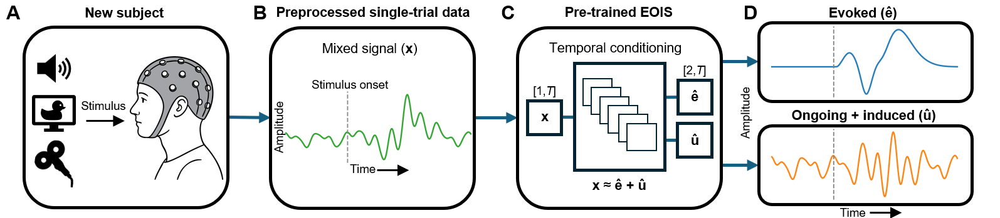

# Evoked–Ongoing/Induced Separator (EOIS)



## 📁 Repository structure
##### ├── 🧊 preprocessing/ # MEG (audio/visual) and TMS–EEG preprocessing with and without calibration phases 
##### ├── 📝 training_testing/ # Model training and testing, including figures and numeric outputs

## 📝 Algorithm description
EOIS is an algorithm for extracting phase-locked ("evoked") and non-phase-locked ("ongoing and induced") components from single-trial MEG and EEG data.
The EOIS framework uses dilated residual networks and multi-subject learning to satisfy convergent phasic features.
EOIS does not require individual within-subject calibration and can therefore be deployed to extract evoked and induced components from single-trial data without previously recorded data from the subject. The method can also be applied when multiple trials have been recorded and preprocessed.

## 📊 Data setup
TMS–EEG (52 subjects), auditory and visual MEG (92 and 219 subjects, respectively), and simulated data were used to train and test the models using a leave-one-subject-out procedure.
The TMS–EEG dataset is not publicly available but can be requested from the corresponding authors for research purposes, subject to ethical approval and data agreements. The MEG dataset can be requested from the Cambridge Centre for Ageing and Neuroscience (https://camcan-archive.mrc-cbu.cam.ac.uk/dataaccess/).

## Citation
### If you find this repository useful, please cite
```bibtex
@article{ahola_eois2026,
    title={Disentangling evoked and induced activity from single-trial neurophysiological time series},
    author={Oskari Ahola and Lisa Haxel and Ulf Ziemann and Risto J. Ilmoniemi and Pantelis Lioumis},
    journal={},
    year={2026}
}
```


